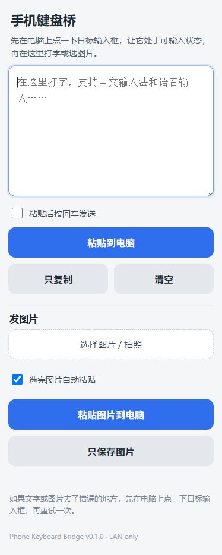
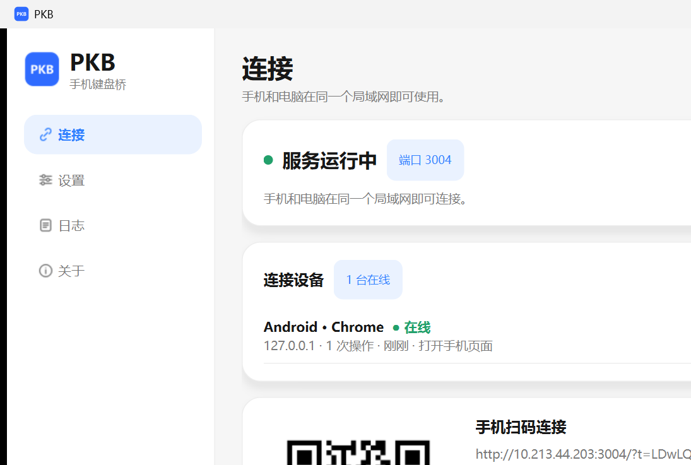
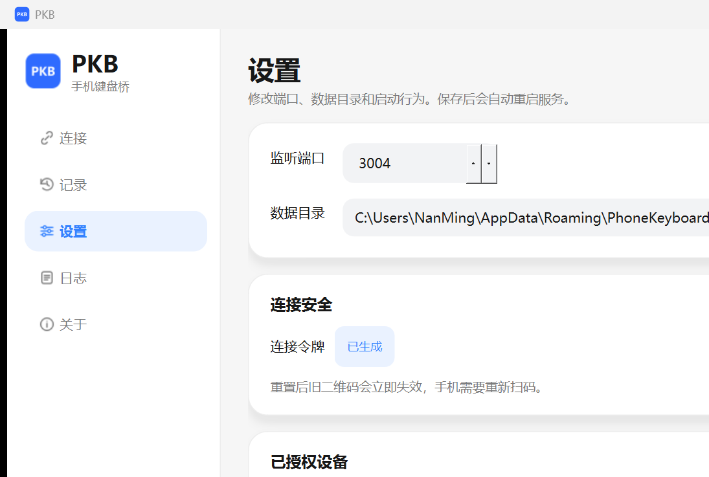
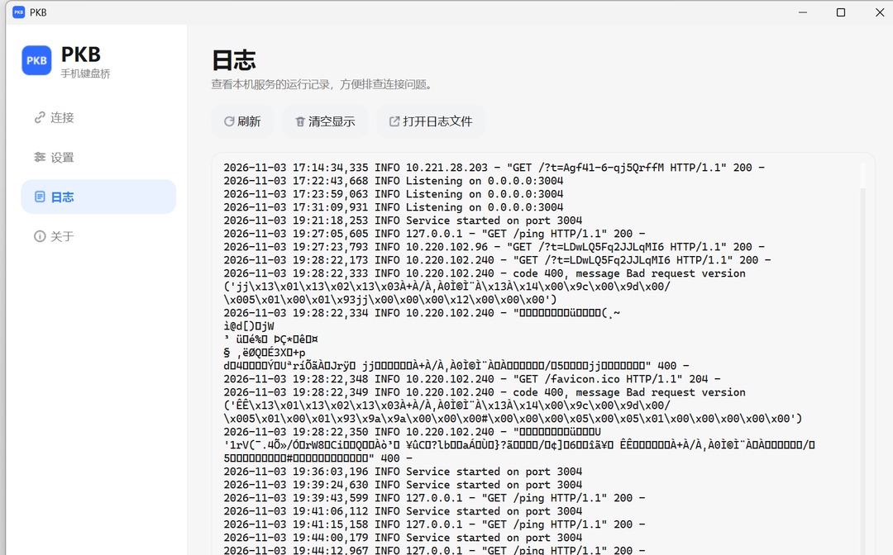
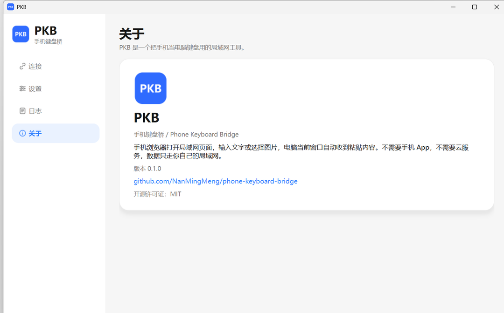

# 手机键盘桥 / Phone Keyboard Bridge

用手机给 Windows 电脑打字：手机浏览器打开一个局域网页面，输入文字或选择图片，电脑当前窗口自动收到粘贴内容。

> 下载 Windows 版：[GitHub Releases](https://github.com/NanMingMeng/phone-keyboard-bridge/releases/latest)

> 适合不想用电脑键盘，但必须在 Codex、微信、浏览器、编辑器里打字的人。
> 不需要安装手机 App，不需要云服务，数据只走你自己的局域网。



## Windows 桌面版 PKB

桌面版把本机服务、连接二维码、设置和日志放进一个窗口里。打开后会自动启动服务，关闭窗口会停止服务。

| 连接 | 设置 |
| --- | --- |
|  |  |

| 日志 | 关于 |
| --- | --- |
|  |  |

桌面版包含四页：

- **连接**：查看服务状态、二维码、手机地址和数据目录。
- **设置**：修改端口、数据目录、开机自启，重置连接令牌。
- **日志**：实时查看运行日志，也可以打开日志文件。
- **关于**：查看版本和项目地址。

界面会自动跟随 Windows 的浅色 / 深色模式。

## 功能

- 手机打字，自动粘贴到电脑当前光标位置
- 支持中文输入法和手机语音输入
- 手机选图/拍照，自动粘贴图片到电脑
- 图片粘贴失败时自动保存到电脑，方便手动拖入
- 二维码连接，手机不用记地址
- 随机令牌保护，局域网内也需要正确链接
- 粘贴成功后手机输入框自动清空
- 支持 Windows 10/11
- 支持打包成单个 exe

## 工作原理

```text
手机浏览器
   │  HTTP（局域网）
   ▼
电脑上的本机小服务
   │  写入剪贴板
   ▼
模拟 Ctrl+V
   ▼
当前获得焦点的窗口（Codex / 微信 / 编辑器 / 浏览器）
```

它不会读取你的屏幕，不会上传文件，也不会连接外部服务器。图片和日志只保存在本机数据目录。

## 安装

### 环境要求

- Windows 10/11
- Python 3.10 或更高版本
- 手机和电脑在同一个 Wi-Fi / 热点下
- 电脑不能睡眠，否则手机连不上

### 方式一：桌面版（推荐）

1. 安装 Python 3.10+。
2. 下载或克隆本项目。
3. 双击 `scripts\start-windows.cmd`。
4. 第一次会自动创建 `.venv` 并安装依赖，然后打开 PKB 窗口。
5. 手机扫描窗口里的二维码即可连接。

也可以直接运行：

```powershell
python run_desktop.py
```

### 方式二：使用打包好的 exe

下载 `PKB.exe` 后双击即可，不需要安装 Python。

### 方式三：命令行版

```powershell
git clone https://github.com/NanMingMeng/phone-keyboard-bridge.git
cd phone-keyboard-bridge
python -m venv .venv
.\.venv\Scripts\activate
python -m pip install -r requirements.txt
python run.py --open-qr
```

启动后窗口会显示类似：

```text
Phone Keyboard Bridge v0.1.0
Local:  http://127.0.0.1:3002/?t=xxxxx
Phone:  http://192.168.1.23:3002/?t=xxxxx
Data:   C:\Users\你\AppData\Roaming\PhoneKeyboardBridge
```

把 `Phone:` 那一行地址发到手机，或者直接扫生成的二维码。

## 使用

1. 先在电脑上点一下你要输入的地方，让光标停在目标输入框里。
2. 手机打开 `Phone:` 地址，或扫描二维码。
3. 在手机页面的大输入框里打字，支持中文输入法和语音输入。
4. 点 **“粘贴到电脑”**。
5. 想直接发送，可以勾选 **“粘贴后按回车发送”**。

### 发图片

1. 电脑上先点一下目标输入框。
2. 手机上点 **“选择图片 / 拍照”**。
3. 默认选完图片会自动粘贴到电脑。
4. 如果目标软件不接受剪贴板图片，点 **“只保存图片”**，图片会保存在数据目录的 `images\` 文件夹里，再在电脑上拖进目标软件。

## 数据保存在哪里

默认目录：

```text
%APPDATA%\PhoneKeyboardBridge
```

里面有：

```text
token.txt                 连接令牌
images\                   手机上传的图片
logs\phone-keyboard.log   运行日志
phone-keyboard-qr.png     最近一次生成的二维码
```

想换位置：

```powershell
python run.py --data-dir D:\PhoneKeyboardData
```

## 安全说明

- 这是局域网工具，不建议把端口暴露到公网。
- 地址里的 `?t=...` 是访问令牌，不要把带令牌的二维码/截图公开分享。
- 文字和图片只在本机与手机之间传输，不经过云端。
- 粘贴会进入“当前获得焦点的窗口”。发送前请确认电脑上点中的是正确输入框。
- 令牌文件在数据目录的 `token.txt`，删除后下次启动会重新生成。

## 常见问题

### 手机打不开地址

- 确认手机和电脑在同一个 Wi-Fi / 热点。
- 确认电脑没有睡眠。
- 确认 Windows 防火墙允许 Python 访问专用/公用网络。
- 电脑 IP 可能变化，重新启动程序生成新的二维码。

### 图片没有自动粘贴

不是所有软件都接受“剪贴板图片”。可以先用 **“只保存图片”**，再在电脑上把图片拖进目标窗口。

### 端口被占用

```powershell
python run.py --port 3003 --open-qr
```

### 中文输入法会不会误发送

页面用按钮发送，不依赖回车；默认不会因为你选字而误发送。只有在勾选“粘贴后按回车发送”时，才会模拟回车。

### macOS / Linux 能用吗

文字复制可以跨平台使用；**自动粘贴和图片剪贴板目前只支持 Windows**。其他系统可以用“只复制”模式，再手动粘贴。

## 打包成 exe

```powershell
.\scripts\build-windows-exe.ps1
```

生成文件：

```text
dist\PKB.exe
```

也可以推送 `v*` 标签，使用 GitHub Actions 自动构建 Windows exe。

## 开发

```powershell
python -m venv .venv
.\.venv\Scripts\activate
python -m pip install -r requirements.txt
python -m unittest discover -s tests -v
python run.py --port 3002 --open-qr
```

项目结构：

```text
desktop/
  app.py             桌面程序入口
  main_window.py     四页主窗口
  theme.py           HyperOS 风格浅色 / 深色主题
  widgets.py         卡片、状态点、导航和开关
  server_controller.py 在后台线程启停 HTTP 服务
  settings_store.py  桌面版配置与开机自启
phone_keyboard/
  cli.py          命令行入口、二维码、局域网地址
  config.py       数据目录、令牌、配置
  clipboard.py    剪贴板与 Windows 自动粘贴
  server.py       HTTP 服务和接口
  templates/      手机页面
assets/           软件图标
docs/             README 截图
scripts/          启动和打包脚本
tests/            基础测试
```

## English

Phone Keyboard Bridge lets you type on your phone and paste into the active window on a Windows PC over your local network. It also supports image upload with automatic clipboard paste when the target app accepts images. The included PKB desktop app manages the local service, QR code, settings, and logs in one window. No cloud service, no mobile app, and no screen capture.

Windows 10/11 is required for automatic paste and image clipboard support. The HTTP server and text copy mode also run on other platforms, but automatic paste is Windows-only.

## License

MIT

